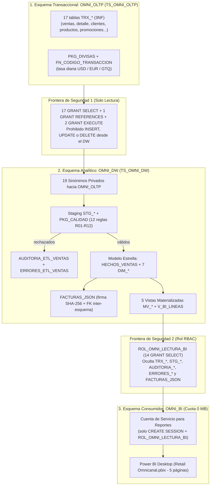

# Plataforma Analítica Omnicanal para Retail — Arquitectura Empresarial Multi-Esquema

[](https://www.oracle.com/database/free/)
[]()
[]()
[]()
[](https://powerbi.microsoft.com/)
[]()

> **Rama `feature/arquitectura-multiesquema`:** Evolución corporativa de la plataforma con **separación física de tablespaces, aislamiento en 3 esquemas (`OMNI_OLTP`, `OMNI_DW`, `OMNI_BI`), sinónimos privados, control de acceso basado en roles (`ROL_OMNI_LECTURA_BI`) y auditoría automatizada de mínimo privilegio**. *(La versión consolidada de un solo esquema se mantiene en la rama `main`).*

Proyecto de **Inteligencia de Negocios de punta a punta** para una cadena de retail omnicanal que opera en **3 canales** (`POS`, `WEB`, `MOB`) y **3 monedas** (`USD`, `EUR`, `GTQ`), normalizando todos los importes analíticos a **USD** con **IVA del 13%**.

---

## Arquitectura Empresarial de 3 Esquemas



---

## Matriz de Gobernanza y Mínimo Privilegio

| Esquema / Rol | Tablespace / Cuota | Privilegios de Sistema | Acceso a Otros Esquemas | Qué tiene bloqueado por Oracle |
| :--- | :--- | :--- | :--- | :--- |
| **`OMNI_OLTP`** | `TS_OMNI_OLTP` (Ilimitada) | `CREATE SESSION`, `TABLE`, `SEQUENCE`, `PROCEDURE` | Ninguno | No ve el DW, no crea vistas materializadas ni jobs |
| **`OMNI_DW`** | `TS_OMNI_DW` (Ilimitada) | `CREATE SESSION`, `TABLE`, `VIEW`, `SEQUENCE`, `PROCEDURE`, `SYNONYM`, `MATERIALIZED VIEW`, `JOB` | `SELECT` en 17 `TRX_*`, `REFERENCES` en `TRX_VENTAS`, `EXECUTE` en `PKG_DIVISAS` y `FN_CODIGO_TRANSACCION` | **Cero escritura en `OMNI_OLTP`** (`INSERT`/`UPDATE`/`DELETE` rechazados con `ORA-01031` / `ORA-41900`) |
| **`ROL_OMNI_LECTURA_BI`** | *(Rol RBAC)* | Ninguno | `SELECT` sobre las 5 `MV_*`, `V_BI_LINEAS`, `HECHOS_VENTAS` y 7 `DIM_*` | Sin acceso a datos crudos ni internos |
| **`OMNI_BI`** | **Sin cuota (`0 MB`)** | Solo `CREATE SESSION` | Recibe `ROL_OMNI_LECTURA_BI` | No puede crear objetos, escribir en el DW ni ver `TRX_*`, `STG_*`, `ERRORES_*` o `FACTURAS_JSON` |

### Decisiones Técnicas Clave
1. **Permisos directos al DW vs Rol para BI:** Oracle PL/SQL (derechos de definidor) ignora roles al compilar paquetes y vistas materializadas, por lo que `OMNI_OLTP` otorga `SELECT`/`EXECUTE` directamente a `OMNI_DW`. En cambio, para los consumidores finales (`OMNI_BI`), se usa el rol `ROL_OMNI_LECTURA_BI` para escalar analistas sin repetir `GRANT`s.
2. **Desacoplamiento por Sinónimos Privados:** `OMNI_DW` define 19 sinónimos privados (`TRX_VENTAS -> OMNI_OLTP.TRX_VENTAS`), permitiendo que el código de `PKG_ETL_VENTAS`, `PKG_CALIDAD` y las vistas permanezca limpio y sin esquemas quemados en código.
3. **Encapsulamiento sin `WITH GRANT OPTION`:** `V_BI_PROMOCIONES` cruza con `TRX_PROMOCIONES` y **no** se expone a `OMNI_BI`; en su lugar se expone `MV_PROMOCIONES_USADAS` (tabla física precalculada en `OMNI_DW`), evitando propagar permisos del OLTP hacia terceros.
4. **Resolución Limpia en `OMNI_BI`:** `OMNI_BI` utiliza `ALTER SESSION SET CURRENT_SCHEMA = OMNI_DW;`, evitando otorgarle `CREATE SYNONYM` mientras conserva intactas sus restricciones de seguridad.

---

## Resultados Verificados (Enero – Septiembre 2026)

| Métrica | Valor Verificado |
| :--- | ---: |
| Transacciones cargadas al DW | **1,133** |
| Líneas en `HECHOS_VENTAS` | **2,805** |
| Venta total con IVA (`TOTAL_LINEA_USD`) | **$2,222,088.30 USD** |
| IVA (13%) | **$255,637.89 USD** |
| Venta neta sin IVA (`MONTO_NETO_USD`) | **$1,966,450.41 USD** |
| Costo de ventas | **$1,459,969.00 USD** |
| Utilidad bruta | **$506,481.41 USD (25.76%)** |
| Diferencias en conciliación DW vs Vistas | **0** |
| Batería QA en `OMNI_DW` (funcional + seguridad) | **40 / 40 aprobadas** |
| Auditoría de aislamiento en `OMNI_BI` | **8 / 8 aprobadas** |

---

## Estructura del Repositorio

```
├── README.md
├── .gitignore
├── bi/
│   └── Retail Omnicanal.pbix                    # Tablero Power BI (5 páginas)
├── data/
│   ├── *.csv                                    # 7 datasets exportados para Power BI
│   └── export_powerbi_csv.sql                   # Exportación desde cuenta de solo lectura OMNI_BI
└── database/
    ├── ddl/
    │   ├── 01_oltp_tables.sql                   # [OMNI_OLTP] 17 tablas TRX_*
    │   ├── 02_staging_tables.sql                # [OMNI_DW]   Tablas STG_*
    │   ├── 03_dw_star_schema.sql                # [OMNI_DW]   HECHOS_VENTAS + 7 DIM_*
    │   ├── 04_facturas_json.sql                 # [OMNI_DW]   FACTURAS_JSON (FK -> OMNI_OLTP.TRX_VENTAS)
    │   └── 05_materialized_views.sql            # [OMNI_DW]   5 MV_* + V_BI_LINEAS
    ├── dml/
    │   ├── 01_seed_catalog_and_september.sql    # [OMNI_OLTP] Catálogos y ventas septiembre
    │   ├── 02_seed_history_jan_aug.sql          # [OMNI_OLTP] Histórico enero-agosto
    │   └── 03_controlled_error_cases.sql        # [OMNI_OLTP] 8 casos de error controlados
    ├── plsql/
    │   ├── pkg_divisas.sql                      # [OMNI_OLTP] PKG_DIVISAS + FN_CODIGO_TRANSACCION
    │   ├── pkg_auditoria.sql                    # [OMNI_DW]   Auditoría + PKG_AUDITORIA
    │   ├── pkg_calidad_datos.sql                # [OMNI_DW]   PKG_CALIDAD (12 reglas R01-R12)
    │   └── pkg_etl_ventas.sql                   # [OMNI_DW]   PKG_ETL_VENTAS
    ├── security/                                # Gobernanza y Permisos Multi-Esquema
    │   ├── 01_grants_oltp_to_dw.sql             # [OMNI_OLTP] Permisos de solo lectura a OMNI_DW
    │   ├── 02_synonyms_dw_to_oltp.sql           # [OMNI_DW]   19 sinónimos privados hacia OMNI_OLTP
    │   └── 03_grants_dw_to_bi_role.sql          # [OMNI_DW]   14 SELECT hacia ROL_OMNI_LECTURA_BI
    ├── tests/
    │   ├── 01_qa_integration_40_tests.sql       # [OMNI_DW]   36 pruebas funcionales + 4 de seguridad
    │   ├── 02_reconciliation_checks.sql         # [OMNI_DW]   Conciliación matemática = 0
    │   ├── 03_kpi_business_queries.sql          # [OMNI_BI]   KPIs de negocio en solo lectura
    │   ├── 04_historical_validation.sql         # [OMNI_DW]   Verificación de 9 meses
    │   ├── 05_mom_monthly_growth.sql            # [OMNI_BI]   Evolución mensual MoM
    │   ├── 06_etl_rejection_report_dw.sql       # [OMNI_DW]   Reporte interno de rechazos ETL
    │   └── 07_bi_security_audit.sql             # [OMNI_BI]   8 pruebas de aislamiento y bloqueo
    └── deploy/
        ├── 00_init_schemas_and_roles.sql        # [SYS]       2 tablespaces, 1 rol y 3 esquemas
        ├── 01_deploy_oltp.sql                   # [OMNI_OLTP] Despliegue transaccional + grants
        ├── 02_deploy_dw.sql                     # [OMNI_DW]   Despliegue analítico + ETL + 40 QA
        ├── 03_verify_bi_readonly.sql            # [OMNI_BI]   Auditoría 8 controles + KPIs
        ├── deploy_all_one_click.sql             # [SYS -> *]  Instalador maestro de 1 solo clic
        └── teardown.sql                         # [SYS]       Limpieza completa de OMNI_*
```

---

## Guía de Despliegue

**Requisitos:** Oracle Database 23ai (por ejemplo, 23ai Free en `FREEPDB1`), SQL Developer / SQLcl / SQL*Plus y Power BI Desktop.

### Opción A — Despliegue Automático de Un Solo Clic (Recomendado)
Conectado como `SYS AS SYSDBA` al servicio `localhost:1521/freepdb1` (conexión `dba`), abre y ejecuta con **F5**:
```sql
@database/deploy/deploy_all_one_click.sql
```
El script crea los 2 tablespaces y 3 usuarios, **cambia automáticamente de sesión** (`SYS` → `OMNI_OLTP` → `OMNI_DW` → `OMNI_BI`), instala todas las capas, corre el ETL, valida las **40 pruebas QA** y ejecuta los **8 controles de seguridad en `OMNI_BI`**, sin tocar `RETAIL_OLTP`.

### Opción B — Despliegue Manual por Esquema

### Paso 0 — Crear Tablespaces, Esquemas y Rol (como `SYS AS SYSDBA`)
```sql
@database/deploy/00_init_schemas_and_roles.sql
```
Crea `TS_OMNI_OLTP`, `TS_OMNI_DW`, `ROL_OMNI_LECTURA_BI` y los usuarios `OMNI_OLTP`, `OMNI_DW` y `OMNI_BI` *(no interfiere con una instalación previa de `RETAIL_OLTP`)*.

### Paso 1 — Desplegar Capa Transaccional (como `OMNI_OLTP`)
```sql
@database/deploy/01_deploy_oltp.sql
```
Crea las 17 tablas `TRX_*`, carga los 9 meses de ventas y los 8 casos de error controlado, compila `PKG_DIVISAS` y otorga permisos de solo lectura a `OMNI_DW`.

### Paso 2 — Desplegar Data Warehouse, ETL y 40 Pruebas QA (como `OMNI_DW`)
```sql
@database/deploy/02_deploy_dw.sql
```
Crea los 19 sinónimos, Staging, Modelo Estrella, Calidad, Facturas JSON, las 5 Vistas Materializadas y `PKG_ETL_VENTAS`; expone los 14 objetos analíticos al rol de BI; ejecuta el ETL y valida las **40 pruebas QA** y la conciliación cero-diferencias.

### Paso 3 — Auditar Cuenta de Solo Lectura y Consultar KPIs (como `OMNI_BI`)
```sql
@database/deploy/03_verify_bi_readonly.sql
```
Ejecuta los **8 controles automáticos (`B01`–`B08`)** verificando lectura de indicadores ($2,222,088.30 USD) y bloqueo efectivo de acceso a `OMNI_OLTP`, `STG_*`, `FACTURAS_JSON`, `ERRORES_*` y operaciones de escritura o DDL.

### Paso 4 — Visualización en Power BI
Abre `bi/Retail Omnicanal.pbix` en Power BI Desktop. Para reiniciar toda la arquitectura desde cero, desconecta las sesiones `OMNI_*` y ejecuta `@database/deploy/teardown.sql` como `SYS`.
