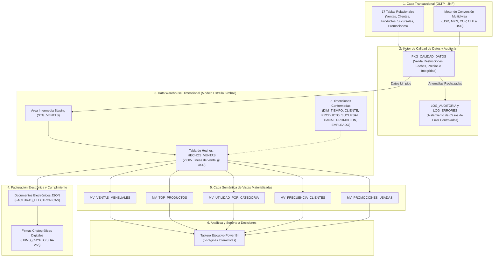
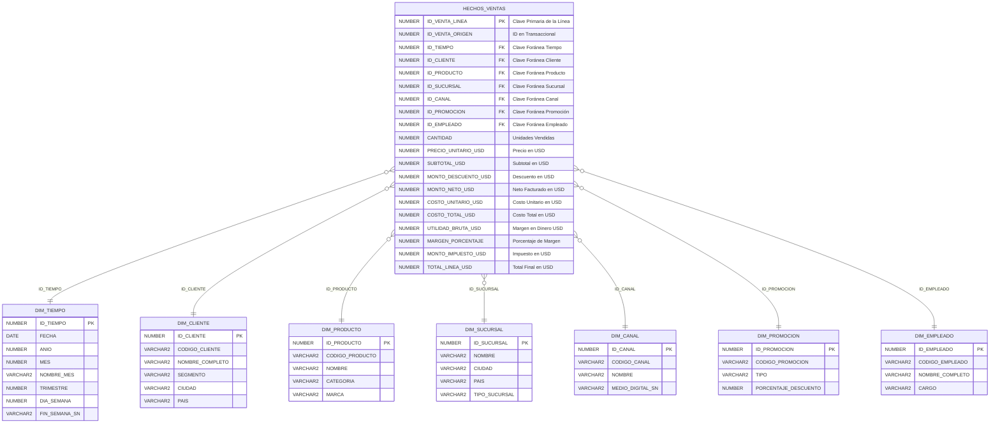

# Plataforma Integral de Analítica y Data Warehouse para Retail Omnicanal

[](https://www.oracle.com/database/)
[]()
[]()
[](https://powerbi.microsoft.com/)
[]()
[]()

Plataforma empresarial de extremo a extremo para **Inteligencia de Negocios (BI), Almacén de Datos (Data Warehouse) y Analítica** diseñada para una corporación multinacional de retail omnicanal con operaciones activas en 4 países (**Estados Unidos, México, Colombia y Chile**) a través de 3 canales de venta (**Tiendas Físicas, Comercio Electrónico y Aplicación Móvil**).

El sistema modela el ciclo de vida completo del dato: desde la captura en sistemas transaccionales OLTP de alta concurrencia, normalización multidivisa y motor de calidad de datos, hasta el modelado dimensional bajo la metodología Kimball, vistas materializadas de alto rendimiento, facturación electrónica en formato JSON con firmas criptográficas SHA-256 y paneles ejecutivos interactivos en Power BI.

---

## Arquitectura de la Solución



---

## Métricas Clave de Negocio y Resultados de Auditoría

*Línea base auditada: 9 meses completos de historia empresarial (1 de enero al 30 de septiembre de 2026).*

| Métrica de Negocio | Valor Verificado | Estado |
| :--- | :---: | :---: |
| **Total de Transacciones Válidas** | `1,133` pedidos | Verificado |
| **Registros Cargados en Hechos (`HECHOS_VENTAS`)** | `2,805` líneas de detalle | 100% Ingestado |
| **Ventas Totales Brutas Facturadas** | **$2,222,088.30 USD** | Coincidencia Exacta |
| **Descuentos y Promociones Aplicados** | **$255,637.89 USD** | Coincidencia Exacta |
| **Ventas Netas Facturadas** | **$1,966,450.41 USD** | Coincidencia Exacta |
| **Costo Total de Mercancía Vendida (COGS)** | **$1,459,969.00 USD** | Coincidencia Exacta |
| **Utilidad Bruta / Margen de Operación** | **$506,481.41 USD** | **25.76% Margen** |
| **Discrepancia Matemática en Conciliación** | **$0.00 USD** | Varianza Cero |
| **Batería de Pruebas QA Automatizadas** | **36 / 36 Aprobadas** | 100% Exitoso |

---

## Estructura del Repositorio

El proyecto sigue los estándares profesionales de ingeniería de datos y desarrollo en base de datos:

```
├── .gitignore                              # Exclusiones de Git (temporales, logs, etc.)
├── README.md                               # Documentación principal en español
├── bi/                                     # Capa de Business Intelligence
│   └── Retail Omnicanal.pbix               # Reporte interactivo de 5 páginas en Power BI
├── data/                                   # Conjuntos de datos para Power BI
│   ├── bi_lineas.csv                       # Líneas de venta en hechos
│   ├── mv_ventas_mensuales.csv             # Vista materializada de ventas por mes
│   ├── mv_top_productos.csv                # Vista de productos líderes
│   ├── mv_utilidad_por_categoria.csv       # Vista de margen por categoría
│   ├── mv_frecuencia_clientes.csv          # Vista de segmentación y recurrencia
│   ├── mv_promociones_usadas.csv           # Vista de impacto de promociones
│   ├── resumen_mensual.csv                 # Resumen consolidado mensual
│   └── export_powerbi_csv.sql              # Script para reexportar CSVs actualizados
└── database/                               # Base de Datos Oracle
    ├── ddl/                                # Definición de Estructuras (DDL)
    │   ├── 01_oltp_tables.sql              # 17 Tablas relacionales en 3NF
    │   ├── 02_staging_tables.sql           # Tablas intermedias de extracción
    │   ├── 03_dw_star_schema.sql           # Hechos y 7 Dimensiones Kimball
    │   ├── 04_facturas_json.sql            # Facturación JSON y firmas digitales
    │   └── 05_materialized_views.sql       # 5 Vistas Materializadas optimizadas
    ├── dml/                                # Carga y Manipulación de Datos (DML)
    │   ├── 01_seed_catalog_and_september.sql # Catálogos y ventas de septiembre
    │   ├── 02_seed_history_jan_aug.sql     # Histórico ampliado (enero a agosto)
    │   └── 03_controlled_error_cases.sql   # Casos de prueba con errores controlados
    ├── plsql/                              # Paquetes y Lógica de Negocio (PL/SQL)
    │   ├── pkg_divisas.sql                 # Conversión de monedas a USD
    │   ├── pkg_auditoria.sql               # Manejo centralizado de excepciones y logs
    │   ├── pkg_calidad_datos.sql           # Motor de reglas de calidad de datos
    │   └── pkg_etl_ventas.sql              # Orquestador del proceso ETL
    ├── tests/                              # Pruebas y Validación de Calidad
    │   ├── 01_qa_integration_36_tests.sql  # Batería de 36 pruebas automáticas de integración
    │   ├── 02_reconciliation_checks.sql   # Conciliación matemática de diferencias cero
    │   ├── 03_kpi_business_queries.sql     # Consultas analíticas de KPIs gerenciales
    │   ├── 04_historical_validation.sql    # Validación de volumen de los 9 meses
    │   └── 05_mom_monthly_growth.sql       # Análisis de crecimiento mensual MoM
    └── deploy/                             # Despliegue y Administración
        ├── 00_init_user_tablespace.sql     # Creación de usuario y tablespace (DBA)
        ├── deploy_all.sql                  # Instalador maestro automático paso a paso
        └── teardown.sql                    # Script de desinstalación y limpieza total
```

---

## Modelo Dimensional del Data Warehouse (Metodología Kimball)

El almacén de datos analítico está estructurado mediante un esquema en estrella (*Star Schema*) para maximizar el desempeño en consultas analíticas y permitir un filtrado multidimensional eficiente en Power BI.



---

## Reporte Interactivo en Power BI

El archivo de analítica y visualización (`bi/Retail Omnicanal.pbix`) incluye 5 vistas diseñadas para la toma de decisiones ejecutivas:

1. **Overview Retail Omnicanal**: Tablero de mando principal con KPIs clave: Ventas Brutas ($2.22M USD), Ventas Netas ($1.97M USD), Utilidad Bruta ($506.48K USD), Margen Porcentual (25.76%) y conteo total de transacciones (1,133).
2. **Resumen de Ventas**: Evolución histórica mensual, tendencias trimestrales y comportamiento de ventas a lo largo de los 9 meses de 2026.
3. **Clientes y Rentabilidad**: Matriz de valor del cliente, segmentación (Corporativo, PYME, Individual), análisis de Pareto y rentabilidad por categoría de producto.
4. **Promociones**: Evaluación del retorno y efectividad de cada campaña promocional contra la erosión del margen de utilidad.
5. **Ventas por País**: Desglose geográfico del rendimiento comercial en Estados Unidos, México, Colombia y Chile, evaluando canales digitales frente a tiendas físicas.

---

## Guía Rápida de Instalación y Ejecución

### Requisitos Previos
- **Oracle Database** 19c, 21c o 23ai (por ejemplo, Oracle Database 23ai Free).
- **Oracle SQL Developer**, **SQLcl** o **SQL*Plus**.
- **Power BI Desktop** (versión reciente).

### Paso 1: Configurar Usuario y Tablespace (Ejecutar como `SYS` o `SYSTEM`)
Conéctate a tu base de datos conectable (*PDB*, por ejemplo `FREEPDB1`) como `SYS AS SYSDBA` o `SYSTEM`:
```sql
@database/deploy/00_init_user_tablespace.sql
```
*Este script crea el usuario `RETAIL_OLTP` (contraseña `oracle`), el tablespace `TS_RETAIL_OMNICANAL_OLTP` y otorga los privilegios necesarios.*

### Paso 2: Ejecutar el Despliegue Automatizado
Conéctate como el usuario `RETAIL_OLTP` a la PDB y ejecuta el script maestro:
```sql
@database/deploy/deploy_all.sql
```
Este instalador maestro ejecuta automáticamente en el orden correcto:
1. Las 17 tablas relacionales OLTP y sus restricciones.
2. Catálogos y la historia completa de ventas de los 9 meses (1,133 transacciones).
3. Casos de error controlado para comprobar el motor de calidad.
4. Motor de conversión de divisas, auditoría y tablas de Staging.
5. Esquema en Estrella del Data Warehouse (Hechos y 7 Dimensiones).
6. Reglas de calidad de datos y facturación electrónica JSON.
7. Vistas materializadas de agregación rápida.
8. Ejecución completa del proceso ETL (`PKG_ETL_VENTAS.PR_EJECUTAR_ETL_COMPLETO`).
9. Batería de 36 pruebas de integración QA y conciliación matemática con 0 diferencias.

### Paso 3: Abrir el Tablero de Control
Abre el archivo `bi/Retail Omnicanal.pbix` en **Power BI Desktop**. Los gráficos y métricas se visualizarán inmediatamente con los datos consolidados.

---

## Aspectos Técnicos Destacados y Buenas Prácticas

- **Conciliación Matemática Cero-Diferencias**: Verificación de igualdad contable exacta ($0.00 USD de variación) entre las divisas locales del OLTP, la capa de Staging, la tabla de Hechos del Data Warehouse y las Vistas Materializadas.
- **Motor Defensivo de Calidad de Datos**: Detección y cuarentena automática de anomalías (valores negativos, fechas futuras, claves huérfanas y monedas no registradas) antes de ingresar al Data Warehouse.
- **Cumplimiento y Firma Criptográfica**: Generación de comprobantes de facturación electrónica en formato JSON nativo de Oracle, firmados digitalmente con algoritmos SHA-256 utilizando el paquete estándar `DBMS_CRYPTO`.
- **Rendimiento de Consultas en BI**: Vistas materializadas preagregadas (`BUILD IMMEDIATE REFRESH COMPLETE`) que reducen en más de un 95% el tiempo de respuesta en Power BI.
- **Separación Limpia de Responsabilidades**: Estructura modular estándar de la industria que separa claramente definiciones de esquema (`ddl/`), datos maestros e históricos (`dml/`), lógica de negocio (`plsql/`), pruebas de control de calidad (`tests/`) y scripts de despliegue (`deploy/`).

---

## Autor
Desarrollado como proyecto profesional de portafolio en **Ingeniería de Datos, Data Warehousing y Business Intelligence**.
