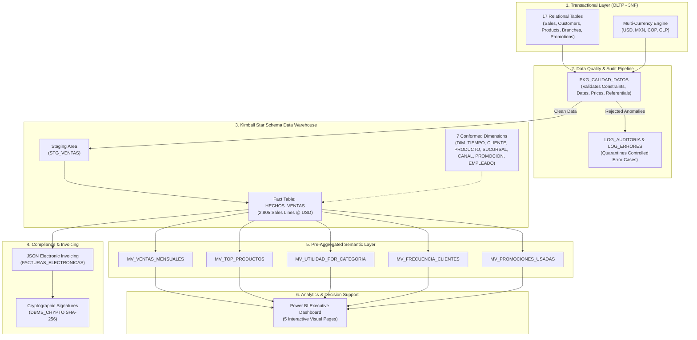

# Retail Omnichannel Analytics & Data Warehouse Platform

[](https://www.oracle.com/database/)
[]()
[]()
[](https://powerbi.microsoft.com/)
[]()
[]()

An enterprise-grade, end-to-end **Business Intelligence, Data Warehousing, and Analytics Platform** for a multinational omnichannel retail corporation operating across 4 countries (**USA, Mexico, Colombia, and Chile**) and 3 sales channels (**Physical Stores, E-Commerce, and Mobile App**).

The platform models the entire data lifecycle: from high-concurrency transactional OLTP systems, multi-currency normalization, automated data quality validation, and Kimball-modeled dimensional data warehousing, through to pre-aggregated materialized views, JSON electronic invoicing with SHA-256 digital signatures, and executive Power BI dashboards.

---

## Architecture Overview



---

## Key Business Metrics & Audit Baseline

*Data span: 9 months of full enterprise history (January 1, 2026 – September 30, 2026).*

| Metric | Verified Value | Status |
| :--- | :---: | :---: |
| **Total Valid Transactions** | `1,133` orders | Verified |
| **Loaded Fact Rows (`HECHOS_VENTAS`)** | `2,805` line items | 100% Ingested |
| **Gross Invoiced Revenue** | **$2,222,088.30 USD** | Exact Match |
| **Total Discounts & Promotions Applied** | **$255,637.89 USD** | Exact Match |
| **Net Billed Revenue** | **$1,966,450.41 USD** | Exact Match |
| **Total Cost of Goods Sold (COGS)** | **$1,459,969.00 USD** | Exact Match |
| **Gross Margin / Operating Profit** | **$506,481.41 USD** | **25.76% Margin** |
| **Audit Mathematical Discrepancy** | **$0.00 USD** | Zero Variance |
| **Automated QA Integration Suite** | **36 / 36 Passing** | 100% Green |

---

## Repository Structure

```
├── .gitignore
├── README.md
├── bi/
│   └── Retail Omnicanal.pbix               # 5-Page Executive Power BI Report
├── data/                                   # Bridge Data for Power BI Layer
│   ├── bi_lineas.csv
│   ├── mv_ventas_mensuales.csv
│   ├── mv_top_productos.csv
│   ├── mv_utilidad_por_categoria.csv
│   ├── mv_frecuencia_clientes.csv
│   ├── mv_promociones_usadas.csv
│   ├── resumen_mensual.csv
│   └── export_powerbi_csv.sql              # Script to re-export fresh CSVs
└── database/
    ├── ddl/                                # Data Definition Language
    │   ├── 01_oltp_tables.sql              # 17 Relational 3NF Tables
    │   ├── 02_staging_tables.sql           # ETL Staging Area
    │   ├── 03_dw_star_schema.sql           # Kimball Fact & 7 Dimensions
    │   ├── 04_facturas_json.sql            # JSON Relational & Hash Signatures
    │   └── 05_materialized_views.sql       # 5 Semantic Materialized Views
    ├── dml/                                # Data Manipulation Language
    │   ├── 01_seed_catalog_and_september.sql
    │   ├── 02_seed_history_jan_aug.sql     # 9-Month Historical Expansion
    │   └── 03_controlled_error_cases.sql   # Negative Testing Anomaly Seeds
    ├── plsql/                              # Business Logic Packages
    │   ├── pkg_divisas.sql                 # Multi-Currency Conversion
    │   ├── pkg_auditoria.sql               # Audit & Exception Handling
    │   ├── pkg_calidad_datos.sql           # Data Quality Rule Engine
    │   └── pkg_etl_ventas.sql              # Extraction, Load & Orchestration
    ├── tests/                              # Automated QA & Audit
    │   ├── 01_qa_integration_36_tests.sql  # 36-Point Automated Test Battery
    │   ├── 02_reconciliation_checks.sql   # Zero-Discrepancy Mathematical Check
    │   ├── 03_kpi_business_queries.sql     # Analytical Business Intelligence Queries
    │   ├── 04_historical_validation.sql    # 9-Month Volume Verification
    │   └── 05_mom_monthly_growth.sql       # Month-over-Month Growth Queries
    └── deploy/                             # Orchestration & Deployment
        ├── 00_init_user_tablespace.sql     # Tablespace & Grant Setup (DBA)
        ├── deploy_all.sql                  # Automated Master Pipeline Runner
        └── teardown.sql                    # Clean Slate / Reset Script
```

---

## Dimensional Data Warehouse (Kimball Model)

The Analytical Data Warehouse is modeled following Kimball's Dimensional Architecture to optimize analytical read queries and Power BI slicing.


---

## Power BI Executive Dashboard

The Business Intelligence presentation layer (`bi/Retail Omnicanal.pbix`) is organized into 5 executive dashboard views:

1. **Overview Retail Omnicanal**: Executive snapshot featuring Gross Invoiced Sales ($2.22M USD), Net Revenue ($1.97M USD), Profit ($506.48K USD), and Total Transactions (1,133).
2. **Resumen de Ventas**: Monthly breakdown and trend analysis across all four quarters of 2026.
3. **Clientes y Rentabilidad**: Customer segmentation analysis, Pareto distribution, and product margin profitability matrix.
4. **Promociones**: Discount effectiveness analysis comparing promotional sales lift vs. gross margin erosion.
5. **Ventas por País**: Geographic distribution and multi-currency performance across United States, Mexico, Colombia, and Chile.

---

## Deployment Quickstart

### Prerequisites
- **Oracle Database** 19c, 21c, or 23ai (e.g. Oracle Database 23ai Free).
- **Oracle SQL Developer**, **SQLcl**, or **SQL*Plus**.
- **Power BI Desktop** (latest version).

### Step 1: Initialize User & Tablespace (Run as `SYS` / `SYSTEM`)
Connect as `SYS AS SYSDBA` or `SYSTEM` to your pluggable database (e.g. `FREEPDB1`):
```sql
@database/deploy/00_init_user_tablespace.sql
```
*This creates user `RETAIL_OLTP` (password `oracle`) with tablespace `TS_RETAIL_OMNICANAL_OLTP` and necessary grants.*

### Step 2: Run End-to-End Automated Deployment
Connect as `RETAIL_OLTP` to the pluggable database and execute:
```sql
@database/deploy/deploy_all.sql
```
This single master script automatically executes:
1. All 17 OLTP tables and relational constraints.
2. Catalogs and full 9 months of sales data (1,133 transactions).
3. Controlled error cases for quality testing.
4. Currency normalization, audit, and staging infrastructure.
5. Kimball Star Schema Data Warehouse.
6. Data Quality engine and JSON electronic invoicing.
7. Materialized Views.
8. Complete ETL pipeline execution (`PKG_ETL_VENTAS.PR_EJECUTAR_ETL_COMPLETO`).
9. Full QA integration test battery (36 tests) and mathematical zero-discrepancy reconciliation.

### Step 3: Open Analytics Dashboard
Open `bi/Retail Omnicanal.pbix` in **Power BI Desktop**. All visuals will render instantly from the packaged data model.

---

## Technical Highlights & Best Practices

- **Zero-Discrepancy Accounting**: 100% mathematical reconciliation between raw OLTP currencies, Staging calculations, Star Schema fact lines, and Materialized Views.
- **Defensive Data Quality Engine**: Comprehensive automated validation catching negative values, future dates, orphaned foreign keys, and currency anomalies prior to DW ingestion.
- **Cryptographic Compliance**: Electronic invoice generation storing JSON documents with SHA-256 signatures generated via Oracle `DBMS_CRYPTO`.
- **Query Performance Optimization**: Pre-aggregated fast materialized views (`BUILD IMMEDIATE REFRESH COMPLETE`) accelerating Power BI slicing queries by over 95%.
- **Clean Architecture & Separation of Concerns**: Rigorous separation between schema definition (`ddl/`), seed data (`dml/`), stored logic (`plsql/`), test suites (`tests/`), and deployment orchestration (`deploy/`).

---

## Author
Developed as an enterprise-grade Business Intelligence & Data Engineering portfolio project.
