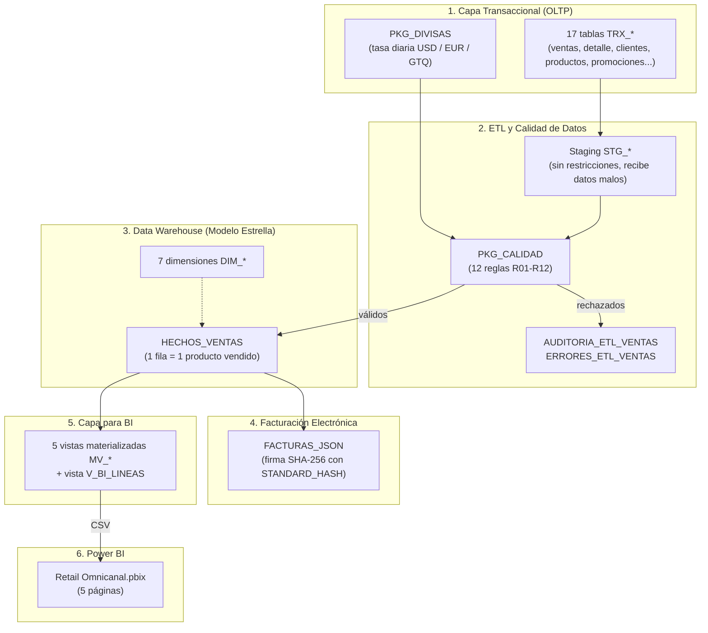
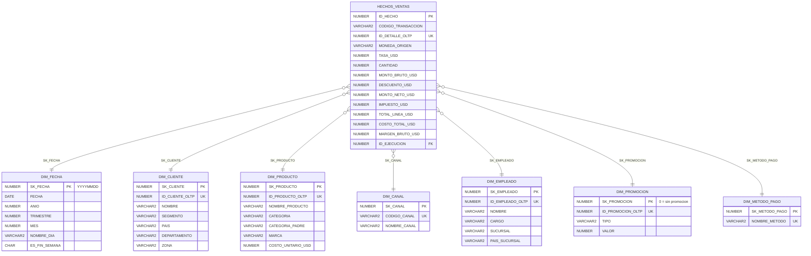

# Plataforma Analítica Omnicanal para Retail — Oracle + Power BI

[](https://www.oracle.com/database/free/)
[]()
[]()
[](https://powerbi.microsoft.com/)
[]()

Proyecto de **Inteligencia de Negocios de punta a punta** para una cadena de retail omnicanal que vende por **3 canales** (Punto de Venta `POS`, Plataforma Web `WEB` y App Móvil `MOB`) y cobra en **3 monedas** (`USD`, `EUR`, `GTQ`), con todos los montos analíticos normalizados a **USD** e impuesto **IVA del 13%**.

El proyecto cubre el ciclo completo del dato: base transaccional OLTP normalizada, conversión de divisas con tasas diarias, área de Staging, motor de calidad con 12 reglas, Data Warehouse en modelo estrella (Kimball), facturación electrónica en JSON con firma SHA-256, vistas materializadas para BI y un tablero en Power BI.

---

## Arquitectura



Todo el flujo se ejecuta con una sola llamada: `PKG_ETL_VENTAS.PR_EJECUTAR_ETL` (extrae → valida → carga dimensiones → carga hechos → refresca vistas → genera facturas → cierra auditoría). La carga es **incremental e idempotente**: re-ejecutarla no duplica datos.

---

## Resultados verificados (enero – septiembre 2026)

| Métrica | Valor |
| :--- | ---: |
| Transacciones cargadas al DW | **1,133** |
| Líneas en `HECHOS_VENTAS` | **2,805** |
| Venta total con IVA (`TOTAL_LINEA_USD`) | **$2,222,088.30 USD** |
| IVA (13%) | **$255,637.89 USD** |
| Venta neta sin IVA (`MONTO_NETO_USD`) | **$1,966,450.41 USD** |
| Costo de ventas | **$1,459,969.00 USD** |
| Utilidad bruta | **$506,481.41 USD (25.76%)** |
| Diferencias en la conciliación DW vs vistas | **0** |
| Pruebas de integración QA | **36 de 36 aprobadas** |

Los datos incluyen **8 casos de error controlados** (venta sin tasa de cambio, total que no cuadra, promoción vencida, promoción de otro producto, precio fuera de vigencia, descuento mayor al importe, geografía inconsistente e impuesto distinto al 13%) para demostrar que el motor de calidad los detecta.

---

## Estructura del repositorio

```
├── README.md
├── .gitignore
├── bi/
│   └── Retail Omnicanal.pbix              # Tablero Power BI (5 páginas)
├── data/                                  # CSV que alimentan Power BI
│   ├── bi_lineas.csv
│   ├── mv_ventas_mensuales.csv
│   ├── mv_top_productos.csv
│   ├── mv_utilidad_por_categoria.csv
│   ├── mv_frecuencia_clientes.csv
│   ├── mv_promociones_usadas.csv
│   ├── resumen_mensual.csv
│   └── export_powerbi_csv.sql             # Regenera los CSV desde Oracle
└── database/
    ├── ddl/                               # Estructuras
    │   ├── 01_oltp_tables.sql             # 17 tablas TRX_*
    │   ├── 02_staging_tables.sql          # Tablas STG_*
    │   ├── 03_dw_star_schema.sql          # HECHOS_VENTAS + 7 DIM_*
    │   ├── 04_facturas_json.sql           # FACTURAS_JSON + firma
    │   └── 05_materialized_views.sql      # 5 MV_* + V_BI_LINEAS
    ├── dml/                               # Datos
    │   ├── 01_seed_catalog_and_september.sql
    │   ├── 02_seed_history_jan_aug.sql    # Histórico enero-agosto
    │   └── 03_controlled_error_cases.sql  # 8 casos de error controlados
    ├── plsql/                             # Lógica de negocio
    │   ├── pkg_divisas.sql                # PKG_DIVISAS
    │   ├── pkg_auditoria.sql              # Tablas de auditoría + PKG_AUDITORIA
    │   ├── pkg_calidad_datos.sql          # PKG_CALIDAD (reglas R01-R12)
    │   └── pkg_etl_ventas.sql             # PKG_ETL_VENTAS (orquestador)
    ├── tests/                             # Validación
    │   ├── 01_qa_integration_36_tests.sql
    │   ├── 02_reconciliation_checks.sql
    │   ├── 03_kpi_business_queries.sql
    │   ├── 04_historical_validation.sql
    │   └── 05_mom_monthly_growth.sql
    └── deploy/                            # Instalación
        ├── 00_init_user_tablespace.sql    # Usuario y tablespace (como SYS)
        ├── deploy_all.sql                 # Instalador maestro
        └── teardown.sql                   # Desinstalación
```

---

## Modelo estrella



- **Grano:** una fila por cada producto vendido dentro de una transacción.
- **Claves sustitutas** (`SK_*`) en todas las dimensiones; la clave del OLTP se conserva para el `MERGE` incremental.
- Dimensiones **tipo 1** (se sobrescriben).

---

## Reglas de calidad (`PKG_CALIDAD`)

| Regla | Severidad | Qué detecta |
| :---: | :---: | :--- |
| R01 | Crítico | Línea duplicada (en el lote o ya cargada) |
| R02 | Crítico | Referencia inexistente (cliente, producto, empleado, canal, método de pago, promoción) |
| R03 | Crítico | Moneda no soportada |
| R04 | Crítico | Sin tasa de cambio para la fecha |
| R05 | Crítico | Cantidad nula, cero, negativa o con decimales |
| R06 | Crítico | Precio negativo o fuera de vigencia |
| R07 | Crítico | Promoción de otro producto, inactiva o vencida |
| R08 | Crítico | Descuento/impuesto negativo o descuento mayor al importe |
| R09 | Crítico | Total de cabecera distinto a la suma del detalle |
| R10 | Crítico | Campo obligatorio vacío |
| R11 | Advertencia | Impuesto distinto al 13% |
| R12 | Advertencia | Departamento o zona del cliente de otro país |

Un error **crítico** rechaza la transacción completa (para que el DW siempre cuadre con el OLTP); una **advertencia** se registra pero la venta se carga.

---

## Tablero Power BI

`bi/Retail Omnicanal.pbix` tiene 5 páginas: **Overview Retail Omnicanal**, **Resumen de Ventas**, **Clientes y Rentabilidad**, **Promociones** y **Ventas por País**.

Power BI se alimenta de los CSV de la carpeta `data/`, generados desde Oracle con `data/export_powerbi_csv.sql`. Así el archivo `.pbix` se puede abrir sin tener Oracle instalado.

---

## Cómo instalarlo

**Requisitos:** Oracle Database 23ai (por ejemplo, 23ai Free), SQL Developer / SQLcl / SQL*Plus y Power BI Desktop.

**1. Crear usuario y tablespace** — conectado como `SYS` (o `SYSTEM`) al PDB `FREEPDB1`:
```sql
@database/deploy/00_init_user_tablespace.sql
```
Crea el usuario `RETAIL_OLTP` (clave de laboratorio `oracle`; cámbiala fuera de un entorno de pruebas) y el tablespace `TS_RETAIL_OMNICANAL_OLTP`. Revisa la ruta del datafile al inicio del script.

**2. Instalar y ejecutar todo** — conectado como `RETAIL_OLTP`:
```sql
@database/deploy/deploy_all.sql
```
Crea todas las capas, carga los 9 meses de datos, ejecuta el ETL, corre las 36 pruebas QA y las conciliaciones.

**3. Abrir el tablero:** `bi/Retail Omnicanal.pbix` en Power BI Desktop.

Para reinstalar desde cero: `@database/deploy/teardown.sql` como `RETAIL_OLTP`.
