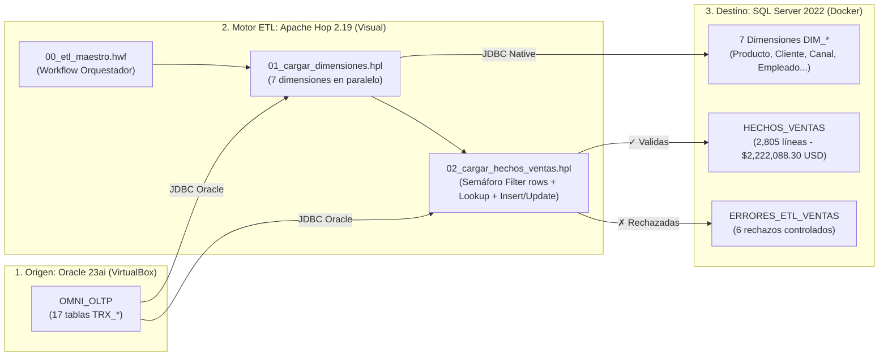

# Integración de Datos con Apache Hop y SQL Server en Docker

Extensión práctica de **Ingeniería de Datos y ETL Visual** para la plataforma analítica omnicanal. Este módulo extrae los datos transaccionales del esquema transaccional en **Oracle 23ai** (`OMNI_OLTP`), ejecuta validaciones de calidad y normalización de divisas en memoria con **Apache Hop 2.19**, y carga el Data Warehouse en un contenedor de **Microsoft SQL Server 2022** (`OMNI_DW_SQL`) en Docker.

---

## Arquitectura de Integración Heterogénea



---

## Componentes del Flujo

| Archivo | Tipo | Función |
| :--- | :--- | :--- |
| **`00_etl_maestro.hwf`** | Workflow | Orquestador maestro de un solo clic. Ejecuta secuencialmente la carga de dimensiones y, al finalizar con éxito, dispara la carga de hechos y errores en **2.3 segundos**. |
| **`01_cargar_dimensiones.hpl`** | Pipeline | Carga en paralelo las 7 dimensiones del modelo estrella (`DIM_PRODUCTO`, `DIM_CLIENTE`, `DIM_CANAL`, `DIM_METODO_PAGO`, `DIM_EMPLEADO`, `DIM_PROMOCION`, `DIM_FECHA`) generando claves sustitutas (`SK_*`). |
| **`02_cargar_hechos_ventas.hpl`** | Pipeline | Extrae las transacciones, convierte montos a USD, aplica el semáforo de calidad (`Filter rows`) desviando los 6 casos de error a `ERRORES_ETL_VENTAS`, resuelve claves foráneas con `Database lookup` e inserta/actualiza incrementalmente en `HECHOS_VENTAS`. |
| **`metadata/rdbms/`** | Metadata | Definición preconfigurada de las conexiones JDBC (`Oracle_OLTP` y `SQLServer_Docker`). |

---

## Resultados Conciliados en SQL Server

Verificados mediante `sqlcmd` directo sobre el contenedor `sqlserver`:

```text
concepto                         cantidad   total_usd
-------------------------------- ---------- -------------
HECHOS_VENTAS (Validas)          2805       $2,222,088.30
ERRORES_ETL_VENTAS (Rechazos)    6          $0.00
```

* **Conciliación financiera:** Cuadre exacto al centavo con el Data Warehouse en Oracle (`$2,222,088.30 USD`).
* **Carga idempotente e incremental:** El transform `Insert / Update` garantiza que re-ejecutar el Workflow no duplica registros (`Output = 0, Errors = 0`).

---

## Requisitos y Ejecución

1. **SQL Server en Docker:** Contenedor activo con base de datos `OMNI_DW_SQL` expuesta en el puerto `1433`.
2. **Oracle 23ai:** Instancia activa con el esquema `OMNI_OLTP` en el puerto `1521`.
3. **Apache Hop:** Abrir Hop GUI, abrir `00_etl_maestro.hwf` y presionar **Play (`▷`) → Launch**.
